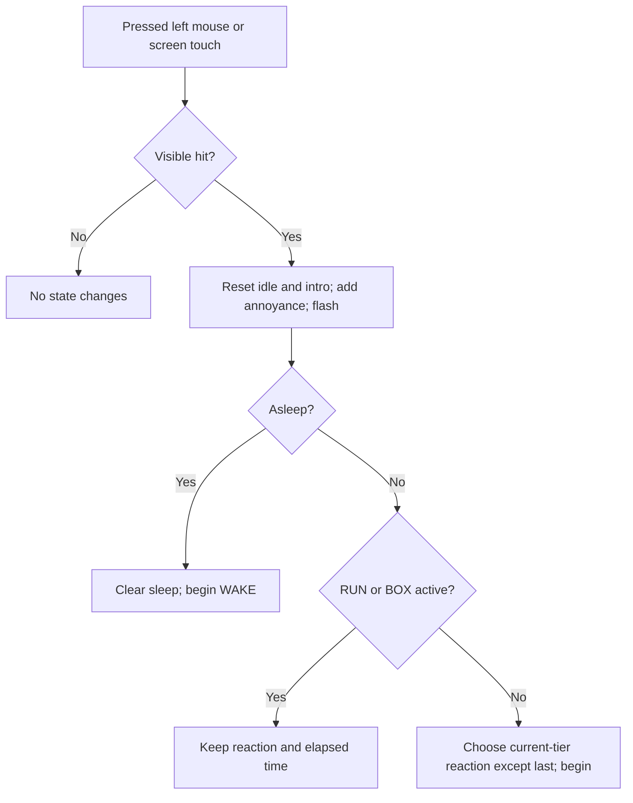

# Public Alpha — implemented behavior and pseudocode

This is a **retroactive description**, not a proposal or approval to change the game. Read [the source audit](ALPHA_SOURCE_AUDIT.md) for immutable source links, function locations and historical evidence. Baseline: published Public Alpha `0.1.0-alpha`, runtime exported from `9788e0343cb888a31ea9092f7409e2455a961261`, preserved by tag `v0.1.0-alpha` at `d61c86568b40c23a291db7aa2757ffe82e1896e8`. Current development snapshot: `8cee57ced64e5640872518e2a3822a6e93c65d03`. The controller calculations below are shared by both snapshots; their typography and version/export settings differ.

Pseudocode means instructions written for people rather than a computer. Names intentionally match GDScript so they can be searched. A **vector** is a pair `(x,y)`; x goes right and y goes down. Coordinates are logical canvas units, not necessarily physical display pixels. Seconds below mean accumulated simulation time. All examples assume no intervening input, resize or focus change unless stated. Unknown motivations and untested conditions are recorded as such, not converted into design intent.

## 1. Architecture and starting state

The entire interactive scene is one `Node2D` named `DontTouchMe` in `main.tscn`, attached to `scripts/blob.gd`. A Node2D is an object Godot can position and draw in two dimensions. There are no physics bodies, child eye objects, collision nodes, animation players, tweens, save system or UI controls. Props and speech are drawings, not independent interactive objects. Alpha additionally uses `scripts/typography.gd` to draw text; main uses the engine font.

Source: `main.tscn`; `blob.gd` declarations, `_ready`, `_resize`. Initialization:

```text
reaction = NONE; last_reaction = NONE
annoyance = idle_time = elapsed = clock = 0; asleep = false
anchor = origin = destination = body_position = (0,0)
body_scale = (1,1); body_angle = 0; eye_open = 1
gaze = idle_gaze = (0,0); gaze_timer = 1; blink_timer = 2.5
blink_remaining = turn_amount = box_amount = sign_amount = 0
direction = 1; bubble = ""; bubble_alpha = touch_flash = 0
intro_alpha = 1; last_size = (0,0); font initially unset
READY:
    randomize the random-number generator
    Alpha: font = Typography.BODY_FONT; enable linear filtering with mipmaps
    main: font = ThemeDB.fallback_font
    RESIZE()
```

An enum is a numbered list: `NONE=0`, then BLINK through WAKE in the order in §7 (1–16). `NONE` has no duration. State is memory-only: restarting resets everything. `last_reaction` remembers the last **started** reaction, including wake and interrupted reactions; it does not mean the last completed reaction. Randomizing at startup does not promise a fixed sequence between launches. Tests set a fixed seed to make their own runs repeatable.

Example: at a 720×1280 logical size, resize sets the resting point to `(360,742.4)`. The body is drawn mostly above that point; this is not the center of a rectangular hitbox. Test: `behavior.gd::run` starts-idle and background checks.

## 2. Input, visible-body hit detection and acceptance

Only a pressed left mouse button or a pressed native screen-touch event is considered. Releases, dragging/motion, hovering and other mouse buttons have no handling. Both input-emulation settings are false, preventing Godot from synthesizing a second path for the same touch. Every finger press is eligible; there is no finger-index filter, debounce, hold gesture or cooldown. Godot calls `_unhandled_input` only for events not already handled elsewhere.

Source: `_unhandled_input`, `contains_touch`, `touch_at`, `_silhouette`, `_box_flaps`; `project.godot [input_devices]`.

```text
UNHANDLED_INPUT(event):
    if event is MouseButton:
        if pressed AND button == LEFT: TOUCH_AT(event.position)
    else if event is ScreenTouch AND pressed: TOUCH_AT(event.position)

CONTAINS_TOUCH(point):
    if box_amount > 0:
        box_pos = body_position + (0, 190*(1-box_amount))
        if box_amount > 0.85:
            for side in [-1, +1]:
                q = (point-box_pos-(side*28,-148)) / (10,8)
                if q.x²+q.y² <= 1: return true
        if point in rectangle(box_pos+(-143,-128), size=(286,139)):
            return false
        for flap in BOX_FLAPS(box_pos):
            if point in flap polygon: return false
    local = rotate(point-body_position, -body_angle) / body_scale
    return point-in-polygon(local, SILHOUETTE())

TOUCH_AT(point):
    if NOT CONTAINS_TOUCH(point): return false
    idle_time = 0; intro_alpha = 0
    annoyance = min(100, annoyance + random_float(7,10))
    touch_flash = 1
    if asleep:
        asleep = false
        BEGIN_REACTION(WAKE, point)
    else if reaction != RUN AND reaction != BOX:
        BEGIN_REACTION(CHOOSE_REACTION(), point)
    return true
```

Division by a vector divides x and y separately. Undoing the rotation and scale puts the tap back into the blob's own coordinates. The tested polygon is the same current, gently wobbling silhouette used for drawing (§9); no invisible resting rectangle follows an old position. The box is an exception: its visible peek eyes accept first, cardboard and flaps block second, remaining exposed blob accepts last. Eye ellipses use `<=1`; polygon edge treatment is delegated to Godot's geometry routine. The rounded cardboard drawing uses a rectangular blocker, so rounded-corner pixels and border/antialiasing are not pixel-perfect hit detection. The sign, its hand, speech, shadow and sleep letters have no extra hit shapes. A point under a drawing can still hit any underlying unblocked blob polygon.

Example: at BOX's middle, `box_amount=1`, the point `body_position+(0,-60)` hits cardboard and is ignored. The point `body_position+(28,-148)` is a peek eye and accepts even though the ordinary body test need not contain it. During RUN, a visible body hit still adds annoyance and resets idle time; it does **not** restart the escape. Programmatic `touch_at` has no viewport-boundary check: offscreen points could hit an offscreen body when supplied directly by a test; a real player cannot click beyond the display.

Tests: `behavior.gd::run` transformed hitbox, cardboard occlusion/peek-eye, mouse/touch/release, rapid tapping and escape checks; `release.gd::run` actual `SubViewport.push_input` on four layouts. The tests do not establish every polygon-edge pixel or every physical touchscreen's event delivery.

## 3. Annoyance, tiers and randomness

A successful hit adds 7–10 before choosing a reaction, capped at 100. Background touches add nothing, do not delay sleep, do not dismiss the introduction, and do not wake. There is no visible meter or cumulative score. Stronger tiers replace earlier pools; this is not a growing list of all previously unlocked reactions.

Source: `tier`, `choose_reaction`, `touch_at`, `POOLS`, `advance`.

| Internal tier | Exact annoyance after the hit | Random candidates before exclusion |
| --- | --- | --- |
| 0, calm | ≤20 | BLINK, SIDE_EYE, SQUISH |
| 1, annoyed | >20 and ≤50 | IRRITATED, DONT, SERIOUSLY, SLIDE |
| 2, angry | >50 and ≤80 | JUMP, SHAKE, FLATTEN, TURN, STOP, SIGN |
| 3, furious | >80 | STOP, SIGN, BOX, RUN |

```text
TIER():
    if annoyance <=20: return 0
    if annoyance <=50: return 1
    if annoyance <=80: return 2
    return 3
CHOOSE_REACTION():
    choices = copy(POOLS[TIER()])
    remove last_reaction from choices if present
    return choices[random_integer(0, count(choices)-1)]
```

All remaining candidates have equal selection probability; there are no weights, scripted first reactions, per-reaction counters or discovery guarantees. The smallest pool still has at least two choices after removal. Sharing STOP/SIGN between the two highest tiers does not defeat exclusion. Wake is outside all pools. `begin_reaction` can directly start any valid reaction, as tests do; pool restrictions apply to ordinary player selection, not that helper. Calling it with `NONE` or an invalid number is not a supported public input and can encounter a missing duration; no general defensive validation exists there.

The same `rng` supplies annoyance increments, reaction indices, blink timing and idle gaze/timing, so time spent idling changes later random samples even with the same initial seed. Protected RUN/BOX hits still consume an annoyance sample but no selection sample. “No consecutive repeats” applies to ordinary `choose_reaction` selection: WAKE bypasses it, so waking, waiting for another sleep and waking again can start WAKE twice without another reaction between. Direct helper calls also bypass exclusion. The shared `clock` never resets on hits; idle breathing/outline phases continue across reactions.

Example: annoyance 18 plus a sampled 8 gives 26, so choose from tier 1 immediately. If the previous started reaction was DONT, IRRITATED/SERIOUSLY/SLIDE each have probability 1/3. If it was SQUISH, all four tier-1 entries have probability 1/4. In a no-decay series from zero, two hits leave 14–20 and the third leaves 21–30: tier 1 starts on the third hit. Higher thresholds have variable crossing counts. Exact boundaries are inclusive on the lower tier: 50 is tier 1, 50.01 tier 2.

Tests: `behavior.gd::run` checks eight boundary values and 250 selections at each; checks every candidate appears in its seeded sample, not a proof that a player sees every reaction. `release.gd::run` checks nonrepetition in long seeded sessions. No test asserts an exact probability distribution.

## 4. Time, relaxation, idle animation and sleep

One simulation clock advances the entire pose. A slow frame contributes at most 0.1 seconds; time lost to a long stall is not caught up. Losing application focus stops automatic processing, so inactivity while unfocused does not accumulate as real-world elapsed time. Direct test calls to `advance` bypass the frame cap and processing flag.

Source: `_process`, `advance`, `_notification`, `_update_pose`.

```text
PROCESS(frame_delta):
    RESIZE()
    ADVANCE(min(frame_delta,0.1))

ADVANCE(dt):                         # exact update order matters
    clock += dt; idle_time += dt
    intro_alpha = move_toward(intro_alpha,0, dt*0.1 if idle_time>5 else 0)
    touch_flash = max(0,touch_flash-dt*5)
    if idle_time>2.5: annoyance = max(0,annoyance-dt*4)
    if reaction != NONE:
        elapsed += dt
        if elapsed >= DURATIONS[reaction]:
            anchor = destination; reaction = NONE; elapsed = 0
    if idle_time>=24 AND reaction==NONE: asleep = true
    blink_timer -= dt; blink_remaining = max(0,blink_remaining-dt)
    if blink_timer<=0:
        blink_remaining=0.17; blink_timer=random_float(2,5)
    gaze_timer -= dt
    if gaze_timer<=0:
        idle_gaze=(random_float(-8,8),random_float(-3,3))
        gaze_timer=random_float(1.8,4)
    UPDATE_POSE()
    request redraw

FOCUS_OUT: disable automatic processing
FOCUS_IN: enable automatic processing
```

The threshold-crossing frame uses its **whole** dt for intro fade/decay once the new idle time passes the threshold. It does not prorate just the part beyond 2.5 or 5. No leftover time is carried into a second reaction; none is queued. Blink/gaze timers reset rather than looping to catch up, and continue to update while asleep or reacting even if their results are overridden visually.

At rest, breath=`sin(clock*(1.6 if asleep else 2.3))`; scale=`(1+0.018*breath,1-0.022*breath)`. Base eye opening is 0.07 asleep, otherwise 0.08 during a natural blink and 1 otherwise. Base gaze equals `idle_gaze`. Natural gaze changes are instantaneous, not interpolated; sleep does not freeze them. There is no physical idle translation/jump. The silhouette itself also wobbles continuously (§9). Normal blinks start first at 2.5 seconds, last 0.17 seconds, then recur on a sampled 2–5-second timer. Initial gaze change is at 1 second, then every 1.8–4 seconds.

The introduction starts at opacity 1, begins fading only after idle time >5 at 0.1 opacity/second, and disappears immediately on the first accepted hit. A miss does not dismiss it. Touch marks last about 0.2 simulation seconds and are reset to full opacity on each hit. Opacity controls visibility; it is a number from invisible (0) to opaque (1).

Sleep starts at idle≥24 only if the reaction has finished; it is independent of annoyance. From 100, roughly 86 annoyance points decay between 2.5 and 24 seconds, so the blob can fall asleep with about 14 remaining. About 27.5 seconds with no hits removes all 100 (frame-boundary details apply). There is no requirement to reach zero first. Only a successful hit clears `asleep`; it immediately starts WAKE, adds annoyance first, and resets inactivity. After waking, the next ordinary hit may interrupt WAKE and uses the current tier. At completion the wake bubble disappears; waking is not a separate permanent mode.

Worked frame example: `idle_time=2.4`, annoyance=100, `advance(0.2)` yields idle=2.6 and annoyance=99.2. Runtime frames normally cap dt at0.1; this larger call is legal in tests. A 2-second real-world stall advances runtime by0.1. A 30-second focus loss advances it by zero automatic seconds. At 24 seconds with an active reaction, sleep waits until completion.

Limitations: focus handling changes processing only; the input handler itself has no focus flag. Sleep eye jitter is reported, not fixed; its discrete gaze timers are a plausible contributor, **not a verified root cause**. Tests: `behavior.gd::run` idle/decay/wake; `release.gd::run` grace period, exact sleep crossing, background cannot wake, focus freeze/resume and long-session recovery. No audio or wall-clock persistence exists.

## 5. State priorities, interruption and movement setup

Most reactions yield immediately to a new accepted touch. RUN and BOX finish on schedule even if exposed parts are hit. This protection applies inside `touch_at`, not inside the lower-level helper. Resizing cancels any reaction, including escape. There is one active reaction, not a collection of overlapping animations.



Source: `begin_reaction`, `_resize`, `_update_pose`, `touch_at`.

```text
BEGIN_REACTION(which,touch):
    origin=(clamp(body_position.x,190,last_size.x-190), anchor.y)
    anchor=origin; destination=origin; elapsed=0
    reaction=which; last_reaction=which
    direction=+1 if touch.x<=origin.x else -1
    if which is SLIDE or JUMP:
        destination.x=clamp(origin.x+direction*155,190,last_size.x-190)
        if abs(destination.x-origin.x)<35:
            reverse direction
            destination.x=clamp(origin.x+direction*155,190,last_size.x-190)
    if which is RUN:
        direction=-1 if origin.x<last_size.x/2 else +1
        destination=(last_size.x/2,anchor.y)
    UPDATE_POSE()

RESIZE():
    size=current logical viewport size
    if size==last_size: return
    last_size=size
    anchor=(size.x*0.5,size.y*0.58)
    origin=destination=anchor; reaction=NONE
    UPDATE_POSE()
```

Input on the left (including equal x) sends evasive movement right; input on the right sends it left. RUN ignores touch direction and selects the nearer side by resting x, with exactly centered origin running right. A slide/jump at a boundary reverses if it would move less than35. It still clamps after reversal; narrow unsupported logical widths cannot guarantee155 units.

Example at width720: allowed origin/destination centers are190…530. From360 with a left-side hit, SLIDE ends at515. From520, first proposed end530 moves only10, so it reverses and ends365. RUN from360 heads to930 (720+210), later returns to360.

A new reaction takes the old body's current x (clamped) but **anchor.y**, discarding any current vertical displacement. Every pose is then reconstructed from base values; no previous scale/angle is blended in. Interrupting a jump can snap vertically to the floor; a shake's current horizontal offset can become the next resting x. Safe state transitions therefore do not imply crossfaded animation. Completion sets anchor=destination and clears reaction, but leaves `last_reaction` unchanged. Resize leaves annoyance, asleep, elapsed, last reaction, clocks, intro and timers intact; elapsed is irrelevant while NONE. Props/bubbles reset in the pose. No redraw is explicitly requested by `_resize` itself; the normal `_process` subsequently calls `advance` and requests one.

Tests: `behavior.gd::run` edge poses/escape spam/resize recovery; `release.gd::run` directly starts every reaction after every other one. That matrix intentionally bypasses touch protection and tests helper robustness, not player permission to interrupt BOX/RUN. There is no queue, tween cancellation callback, physics velocity, pathfinding or collision avoidance.

## 6. Pose mathematics shared by all reactions

Source: `_ease`, `_update_pose`. A normalized time `t` is elapsed divided by duration; 0 is the start, 1 the end. `sin`/`cos` use radians; PI is a half-turn and TAU is a full turn. `lerp(a,b,u)` means `a+(b-a)*u`. `clamp` confines a value to limits; `exp` is the exponential function. These are formulas, not additional animation objects.

```text
EASE(v):
    u=clamp(v,0,1)
    return u*u*(3-2*u)             # smooth start and finish

UPDATE_POSE():
    body_position=anchor
    breath=sin(clock*(1.6 if asleep else 2.3))
    body_scale=(1+breath*0.018,1-breath*0.022)
    body_angle=0
    eye_open=0.07 if asleep else (0.08 if blink_remaining>0 else 1)
    gaze=idle_gaze
    turn_amount=sign_amount=box_amount=0
    bubble=""; bubble_alpha=0
    if reaction==NONE: return
    t=clamp(elapsed/DURATIONS[reaction],0,1)
    E=sin(PI*t)
    H=EASE(7*t)*EASE(7*(1-t))
    bubble_alpha=H
    apply the matching reaction row below
```

`E` is a smooth rise-and-fall envelope:0→1→0. `H` reaches1 after the first1/7 of time and holds until the final1/7, then falls. Additive scales below add to the breathing scale; assignment replaces it. Unmentioned properties retain their base values. Reaction code can override natural blinking, gaze and sleeping eye opening. Natural blink is not a separate reaction and does not update `last_reaction`.

Example: `EASE(0.5)=0.5`; at half-time E=H=1, but the breathing contribution still depends on the shared clock. Many reactions retain narrowed eyes through their last frame and revert when state becomes NONE; not every property eases to neutral.

## 7. All sixteen reactions, exact pose instructions

Source for every row: `blob.gd::_update_pose`, `DURATIONS`, `POOLS`, with `begin_reaction` for initial movement. Entry conditions are §2–5. The following are complete reaction-specific overrides; §6's base values always run first. All use the same completion logic (§4). IDs follow the enum, not a new feature list.

### 1 — BLINK (0.65 s; calm)

The blob squeezes its eyes shut in surprise and stretches slightly.

```text
eye_open=1-0.96*sin(PI*t)^2
body_scale += (-0.04,+0.06)*E
```

At t=.5, opening=.04, so rendered eye height still has the2-unit minimum. No dialogue. It differs from the0.17-second natural blink, and is selected only by a calm hit. Test: behavior every-reaction loop and render state1. Limitation: this override ignores any natural blink underneath.

### 2 — SIDE_EYE (1.15 s; calm)

The eyes look toward the touching side and partially close while the body tilts.

```text
gaze=(-18*direction,-2)*H
eye_open=1-0.4*H
body_angle=-0.06*direction*E
```

A left hit gives direction+1 and gaze x=-18 at the hold. No pupils move independently: the entire white eye shapes move. Test: every-reaction/finite-pose/layout loops, render state2. Limitation: these tests do not judge whether the expression reads as side-eye to people.

### 3 — SQUISH (0.85 s; calm)

The blob briefly spreads wider and compresses, then recovers early.

```text
q=sin(PI*min(1.5*t,1))*exp(-1.5*t)
body_scale += (0.34,-0.38)*q
```

At t=1/3, q=`exp(-.5)`≈.60653, adding≈(.20622,-.23048). At t≥2/3 q=0 (within floating-point precision). Test: every-reaction bounds/positive-scale, render state3. No per-touch indentation or physical deformation model.

### 4 — IRRITATED (1.2 s; annoyed)

The blob narrows its eyes and makes one small angular oscillation.

```text
eye_open=1-0.78*H
gaze=(0,4)
body_angle=sin(TAU*t)*0.04
```

At midpoint eyes=.22 and angle≈0. Gaze jumps to the assigned value, not an eased interpolation. Test: every-reaction/render state4. Limitation: annoyance does not persistently narrow idle eyes; expression belongs to this active reaction.

### 5 — DONT (1.25 s; annoyed)

It says “Don't.” and tilts slightly.

```text
bubble="Don't."; eye_open=0.65
body_angle=-0.055*E
```

At midpoint angle=-.055 radians; bubble opacity H=1. Test: every-reaction, dialogue-width checks, typography phrase coverage, render state5. Limitation: eye narrowing stays constant until completion rather than easing.

### 6 — SERIOUSLY (1.5 s; annoyed)

It says “Seriously?”, looks up, and gives one eye a more skeptical squint.

```text
bubble="Seriously?"
gaze=(0,-9)*H; body_angle=0.12*E
# DRAW additionally multiplies the left eye's opening by0.5
```

At midpoint tilt=.12; if no underlying blink, right opening1, left.5. Test: every-reaction/dialogue/typography, render state6. The asymmetric eye is a drawing rule, not stored in `eye_open`.

### 7 — SLIDE (0.9 s; annoyed)

It glides away horizontally with a low, wide pose.

```text
body_position=lerp(origin,destination,EASE(1.5*t))
body_scale += (0.2,-0.12)*E
gaze.x=-15*direction             # gaze.y remains idle_gaze.y
```

Movement reaches destination at t=2/3 (0.6 s), then pose recovers for0.3 s. With360→515, t=1/3 gives x437.5. Test: movement/bounds/all-aspect/interruption, render state7. There is no friction simulation.

### 8 — JUMP (1.05 s; angry)

It hops away, taller and narrower in the air.

```text
body_position=lerp(origin,destination,EASE(t))
body_position.y -= 175*E
body_scale += (-0.14,+0.22)*E
body_angle=0.18*direction*E
```

At t=.5 it is175 units above anchor and halfway horizontally. Test: full-body bounds/edge poses/interruption, render state8. The arc is prescribed, not gravity; an interrupt discards current jump height.

### 9 — SHAKE (1.05 s; angry)

It shudders rapidly with narrowed eyes.

```text
body_position.x += sin(TAU*t*11)*15*E
body_angle=sin(TAU*t*9)*0.09*E
eye_open=0.3
```

There are11 horizontal cycles and9 angular cycles over the normalized reaction. Maximum possible x amplitude is15, reduced by E near endpoints. Test: every-reaction/positive-scale/bounds, render state9. A single still image cannot prove perceived smoothness.

### 10 — FLATTEN (1.65 s; angry)

It becomes a thin pancake and says “Can't touch this.”

```text
body_scale=(1+0.45*H,1-0.78*H)
eye_open=1-0.55*H; bubble="Can't touch this."
```

At hold, scale=(1.45,.22) and eye opening=.45. Hit detection uses this flattened polygon; it does not disable touching. Test: transformed hitbox/bounds/dialogue/typography, render state10. The phrase is comedy, not literal invulnerability.

### 11 — TURN (1.8 s; angry)

It appears to turn away: eyes fade/narrow and a small rear arc appears.

```text
turn_amount=H
body_scale.x=1-0.22*sin(PI*H)
# DRAW hides eyes when turn_amount>=0.97, adds rear arc above0.1
```

At H=.5 x scale=.78; at H=1 it returns to1 while eyes vanish. This is simulated rotation through width/opacity, not actual 3D turning or disabling hits. Test: reaction/layout/render state11. Underlying polygon still accepts touches.

### 12 — STOP (1.25 s; angry or furious)

It swells and shakes a little while shouting “STOP.” in larger text.

```text
bubble="STOP."
body_scale += (0.14,0.16)*E
eye_open=0.3+0.7*(1-H)
body_position.x += sin(70*t)*4*E
# Bubble uses size43 instead of31
```

At midpoint eyes=.3; additive scale=(.14,.16). `70*t` is radians, not70 full cycles. Test: bounds/dialogue/typography/render state12. Shared high-tier membership still obeys nonrepetition.

### 13 — SIGN (2.0 s; angry or furious)

It raises a tiny NO sign; the hand/sign stay upright in world coordinates.

```text
sign_amount=H; eye_open=0.45; gaze.x=-12
# DRAW_SIGN uses sign_amount for pole extension, see §10
```

At t=.5 the pole top is115 units above its base. Gaze.y remains idle gaze; sign is not a blocker or separate tappable target. Test: reaction/layout/render state13 and typography “NO”. The sign panel is not opacity-faded; it is drawn whenever amount>0 and moves with the pole.

### 14 — BOX (2.7 s; furious)

Cardboard rises in front of the compressed body; peek eyes appear near the top.

```text
box_amount=H
body_scale.y=1-0.3*H
gaze=(0,-12)
# DRAW_BOX and CONTAINS_TOUCH share flap geometry; see §2 and §10
```

At hold, body y-scale=.7, box_pos=body_position; when amount>.85 its separate peek eyes are visible and accept hits. Those hits add annoyance but don't restart BOX. Cardboard itself does nothing. Test: occlusion/peek-eye/escape spam/render state14. The box is drawn without an opacity fade and is not an inventory item; no persistent hiding state remains after completion.

### 15 — RUN (4.1 s; furious)

It escapes, waits offscreen, peeks from the edge, then cautiously returns to center.

```text
outside=(-210 if direction<0 else last_size.x+210,anchor.y)
if t<0.23:
    body_position=lerp(origin,outside,EASE(t/0.23))
    body_scale=(1.22,0.83); body_angle=direction*0.2
else if t<0.52:
    body_position=outside
else if t<0.7:
    peek=(45 if direction<0 else last_size.x-45,anchor.y)
    body_position=lerp(outside,peek,EASE((t-0.52)/0.18))
    gaze.x=-direction*18
else:
    peek=(45 if direction<0 else last_size.x-45,anchor.y)
    body_position=lerp(peek,destination,EASE((t-0.7)/0.3))
    gaze.x=-direction*12
body_position.y -= abs(sin(55*t))*9
```

Phase boundaries are0.943,2.132,2.87 and4.1 seconds. At exactly.23 the second branch starts and the first branch's running scale/angle no longer applies: base breathing/zero angle resume. Hopping continues in **all** phases, even offscreen and at t=1 if sampled directly. Normal `advance` completes before posing t≥1, replacing that pose with idle at destination. Test: lifecycle/escape spam/resize recovery/render state15. Offscreen body and peek intentionally exceed ordinary horizontal visibility checks; no run collision or footstep system exists.

### 16 — WAKE (1.65 s; successful hit while asleep only)

It startles upward and complains “I was DREAMING.” before narrowing its eyes.

```text
bubble="I was DREAMING."
body_position.y -= sin(PI*min(2*t,1))*100
body_scale += (-0.12,0.24)*E
eye_open=1.35 if t<0.55 else 0.4
```

At t=.25 it is100 units up; at t=.5 vertical startle has returned to the floor. At0.9075 seconds (t=.55) eye opening switches abruptly from1.35 to.4. Touch wake is checked before RUN/BOX protection; ordinary runtime never sleeps during an active reaction, but a manually forced asleep/protected combination would wake. Test: sleep/wake/background/input, every-reaction/dialogue/typography/render state16. Wake is interruptible by the next ordinary successful hit and isn't randomly selectable.

## 8. Eyes and face attachment

Source: `_draw` inside the body transform. Both white eyes are polygons filled with warm white; there are no separate pupils.

```text
set drawing transform to position=body_position, rotation=body_angle, scale=body_scale
draw SILHOUETTE() in INK
if turn_amount<0.97:
    face_alpha=1-turn_amount
    for side in [-1,+1]:
        eye_center=(side*37+gaze.x,-113+gaze.y)
        opening=eye_open
        if reaction==SERIOUSLY AND side<0: opening*=0.5
        radius=(13.5*(1-0.8*turn_amount), max(2,21*opening))
        draw ELLIPSE(eye_center,radius,WHITE with alpha=face_alpha)
if turn_amount>0.1:
    draw rear arc: center(0,-105), radius21, angles0.35…1.5,
                   20 segments, color(.30,.30,.31,turn_amount*.45), width2
if touch_flash>0:
    for side in [-1,+1]:
        draw line (side*136,-143) to (side*(136+13*touch_flash),-151)
        using MUTED alpha=touch_flash, width3
reset drawing transform to identity
```

The eye world position is `body_position + rotate(eye_center*body_scale,body_angle)`. Thus breathing, squash and tilt transform eyes with the body. However the silhouette's local surface wobble does not move the eye centers, and timed gaze changes can move them separately. Eyes never close to zero height:2 is the minimum radius. At asleep opening .07,21*.07=1.47, so the minimum applies. Example: idle awake with zero gaze has centers(-37,-113),(37,-113) relative to the body; during sleep the centers still use changing `idle_gaze`. At full TURN the ordinary eyes disappear; BOX peek eyes are separate untransformed drawings.

Tests: pose/positive scale checks and render snapshots; no automated optical/jitter assertion. Known reported issue: sleep-eye motion (§12). There is no facial inverse-kinematics system (a solver that repositions parts to maintain a constraint).

## 9. Silhouette, geometry, scaling and draw order

Source: `_silhouette`, `_ellipse`, `_draw`, `project.godot` display/rendering settings.

```text
SILHOUETTE():
    points=[]
    for i=0…79:
        a=TAU*i/80
        x=cos(a)*117*(1+0.035*sin(3*a+clock*1.1))
        y=sin(a)*119
        if y>0: y*=0.61
        append (x,y-73)
    return points
ELLIPSE(center,radius,color):
    for i=0…47:
        a=TAU*i/48
        append center+(cos(a),sin(a))*radius
    draw filled polygon(points,color)
DRAW():
    if font unset: return
    draw introduction when intro_alpha>0
    height=max(0,anchor.y-body_position.y)
    draw shadow at (body_position.x,anchor.y+5),
        radius=(111-min(height*.2,45),13), color(.35,.31,.24,.075)
    draw transformed body, face, rear arc, touch marks (§8)
    restore identity transform
    if sign_amount>0: DRAW_SIGN()
    if box_amount>0: DRAW_BOX()
    if bubble!="" AND bubble_alpha>0: DRAW_BUBBLE()
    if asleep: draw three sleep letters (§10)
```

Warm canvas clear color is(.965,.949,.914,1); named colors include INK `202124`, WHITE `fffdf8`, MUTED `aaa395`, PAPER `f6f2e9`. PAPER is declared but not read by the controller. Actual game background uses project clear color. Silhouette radius is117 horizontal with3.5% local wobble,119 vertical above the center, lower half compressed by.61, then shifted upward73. Approximate unscaled vertical range is-192…-.41. Shape is not a circle hitbox or downloaded sprite. Draw and hit-test calls independently regenerate the same80 points at the same simulation clock.

Canvas reference720×1280 uses `canvas_items` stretch with aspect `expand`. Logical canvas can gain width/height on differing aspect ratios; `_resize` reads the viewport, places anchor at50% width/58% height and cancels motion if that logical size changes. Initial desktop window override432×768 is a display preview size, not a separate world. Mobile orientation setting1 requests portrait. The body isn't proportionally enlarged by a custom per-device calculation: Godot canvas stretch maps logical coordinates to screen pixels. Compatibility rendering (`gl_compatibility`) is configured for desktop/mobile; Android ETC2/ASTC texture importing is enabled. No explicit frame-rate limit, safe-area calculation, notch handling, shader effect, culling optimization or landscape layout exists in this script.

Example: a720×1600 logical viewport anchors at(360,928), while960×1280 anchors at(480,742.4). The190-unit margins are absolute logical units, not a percentage. Logical widths below380 make the clamping interval inverted; the project reference and tested layouts avoid that. Arbitrarily tiny viewports, landscape and display cutouts aren't certified by the bounds tests. Per-frame allocations (polygons/style boxes) are small but not profiled on ordinary physical phones. Tests: behavior edge checks, release four-layout checks, render four-aspect sheet. These check body bounds, not every prop against every possible display shape.

## 10. Introduction, speech, sign, box and sleep marks

Source: `_draw`, `_text_center`, `_draw_sign`, `_panel`, `_box_flaps`, `_draw_box`, `_draw_bubble`.

The title is centered at `(width/2,height*.25-42)`, size40; “a little personal space, please.” at `(width/2,height*.25)`, size23; “(especially the little one)” at `(width/2,height*.84)`, size19 with intro alpha*.8. Title/captions use MUTED/INK as in source. Fade timing is §4. There is no persistent HUD.

```text
DRAW_SIGN():
    base=body_position+(102,-55)
    top=base+(30,-115*sign_amount)
    pole from base to top: color a68a62, width7
    panel at top-(50,53), size(100,65), WHITE, radius10, border d6cec0
    center text "NO" at top-(0,9), size34, INK
    draw hand ellipse at base, radius(18,12), INK

PANEL(color,radius,border=transparent):
    create StyleBoxFlat with background color, all corner radii=radius
    border color=border; border widths=2 if border alpha>0 else0
    enable antialiasing; return style

BOX_FLAPS(pos):
    return polygons pos+[(-143,-128),(-162,-161),(-10,-149),(0,-128)]
                   and pos+[(0,-128),(16,-150),(158,-158),(143,-128)]

DRAW_BOX():
    pos=body_position+(0,190*(1-box_amount))
    panel pos+(-143,-128), size(286,139), c6a77e, radius5, border ae8f67
    center tape from pos+(0,-128) to pos+(0,10), dfc69f, width32
    top line from pos+(-143,-126) to pos+(143,-126),997c59,width3
    fill BOX_FLAPS(pos) with ddc49f and d5b98e respectively
    text "definitely empty" at pos+(-3,-44),size19,color826a4c
    if box_amount>0.85:
        for side in [-1,+1]: eye ellipse pos+(side*28,-148),radius(10,8),WHITE

DRAW_BUBBLE():
    size=43 if STOP else31
    width=measured text advance +54
    center.x=clamp(body_position.x,width/2+18,last_size.x-width/2-18)
    center.y=max(110,body_position.y-290)
    center.y += (1-bubble_alpha)*10
    paper=WHITE with alpha=bubble_alpha
    panel: center-(width/2,43),size(width,78),radius22,paper
    triangle: center+[(-9,31),(10,31),(0,48)],paper
    centered text at center+(0,7),size,INK with alpha=bubble_alpha

SLEEP_MARKS():
    for i=0…2:
        phase=positive_mod(clock*.35+i*.32,1)
        pos=body_position+(76+38*phase,-198-85*phase)
        text="z" if i<2 else "Z"; size=19+5*i
        color=MUTED with alpha=sin(phase*PI)*.7
        draw centered text at pos
```

Sign/box use world positions after resetting the body drawing transform, so they don't inherit breathing scale/tilt. Bubble is drawn after props; sleep marks are last. The shadow follows body x but remains at anchor y+5 and shrinks in width on jumps; it is not a collision surface. No speech queue, word wrapping, voice or localization exists. Bubbles use short hardcoded English; if future dialogue is too wide, the clamp interval can become invalid. The triangle points under the **bubble center**, not dynamically toward a displaced blob. INTRO uses title flag only for “Don't Touch Me” in Alpha; sleep letters use the normal font fallback in its typography adapter.

Worked Alpha bubble: “I was DREAMING.” has stored advance1362 at size160. At size31 measured width=263.8875; panel width=317.8875 and center x is kept at least176.94375 from either edge. On a720-wide viewport at body x190, center x remains190. Tests: release dialogue fits, typography exact-width scaling, package manifest checks and render sheet. No automated screenshot semantic or prop-hitbox pixel comparison is present.

## 11. Alpha typography versus development text

Source: Alpha `scripts/typography.gd::{width,draw_text}`, `assets/typography/phrases.gd`, `assets/fonts/title.tres`; main `_ready`, `_text_center`, `_draw_bubble`. These are presentation differences, not different reaction rules.

```text
ALPHA WIDTH(text,size,title=false):
    if NOT title AND text exists in cached PHRASES:
        return phrase.advance * size /160
    return measured advance in (TITLE_FONT if title else BODY_FONT)
ALPHA DRAW_TEXT(canvas,text,baseline,size,color,title=false):
    if NOT title AND text exists in PHRASES:
        scale=size/160
        offset=(16,phrase.ascent+16)*scale
        draw phrase texture in rectangle(baseline-offset,texture.size*scale), tinted color
        return
    draw string with TITLE_FONT if title else BODY_FONT
CENTER_TEXT(...):
    draw at center-(WIDTH(text,size,title)/2,0)
MAIN CENTER_TEXT(...):
    measure and draw using ThemeDB.fallback_font directly
```

BODY_FONT is bundled Space Grotesk; TITLE_FONT is its variation with weight600. Ten complete Ink Free phrase images are cached at base size160/padding16: the two captions, marketing phrase “A tiny interactive comedy.”, Don't., Seriously?, Can't touch this., STOP., I was DREAMING., NO, definitely empty. Their advances in that order are2015,1672,1739,394,663,1135,438,1362,225,1084; ascent107 for all. “A tiny interactive comedy.” is marketing text, not an additional gameplay bubble. No Ink Free font file, per-letter atlas or installed-font lookup is needed by the shipped runtime. Unknown phrases fall back to Space Grotesk; tests flag current unrepresented dialogue but runtime itself permits fallback. Title and sleep z/Z use Space Grotesk. Mipmaps/linear filtering soften scaled raster phrase images.

Authoring `generate_typography.gd` uses a licensed locally installed Ink Free font with fallback disabled, draws a2-pixel white outline and white fill, captures a transparent viewport sized from advance/ascent/descent plus padding, saves PNGs and the metrics map. It refuses absent `--finalize-release` or absent/wrong font. This tool is not gameplay and was **not run** for this documentation. Main intentionally has neither adapter nor font/phrase resources. Tests: Alpha `tests/typography.gd`127 historical checks; main intentionally omits that suite. See journal for why authoring is separated.

## 12. Known issues, edge conditions and evidence limits

| Observation or limitation | Status / exact scope | Existing coverage |
| --- | --- | --- |
| Sleeping eyes visibly jump | Owner-reported; planned in `plans/sleep-eye-jitter.md`; not reproduced or root-caused in this documentation pass. Hide fully sleeping eyes is a preferred proposal, not shipped behavior. | Render/pose suites do not measure temporal eye smoothness. |
| Short-reaction interruption can snap pose | Verified from resetting pose and choosing anchor.y; current implementation, not silently “fixed.” | Direct all-pairs completion matrix; no perceptual crossfade test. |
| Sleep gaze still changes discretely | Source-verified every1.8–4 s after first timer; causation of reported jitter remains unknown. | Timers are exercised; no isolated gaze-jitter assertion. |
| Tiny logical widths/cutouts | Fixed190 margin and unwrapped bubbles have no general tiny-screen or safe-area solution. | Four supported logical layouts, not arbitrary viewport proof. |
| RUN has phase-boundary pose changes | First-phase scale/angle disappear at t=.23; intentional code path, motivation unknown. | Lifecycle/bounds exemption/render sample. |
| Focus pause concerns processing only | Clock freezes automatically; input and direct calls have no extra pause guard. | Focus notification assertions, not OS event delivery certification. |
| Randomness has no discovery guarantee | Correct by source: exclusive tier pools, equal random choice except last. | Seeded reachability samples, not guaranteed player sequence. |
| Internal helpers trust caller | Invalid reaction IDs, negative dt or extreme test sizes aren't validated. | Tests use supported values; player input cannot select an ID. |
| No sound/save/settings/counters/trust | Absent from Alpha and audited main; roadmap only. | Offline/no-persistence checks are source scans, not a full dependency security audit. |
| Native mobile behavior | Historical emulator/core checks do not establish current Alpha physical-device performance or iOS execution. | See source audit for test provenance. |

The full formula and branching description above is the behavioral reference for the audited snapshots, including awkward transitions. Future approved changes must update it (or create a versioned successor), the source audit and the journal; retain this Alpha baseline through immutable links. No existing behavior is reclassified here as a requested new feature.
